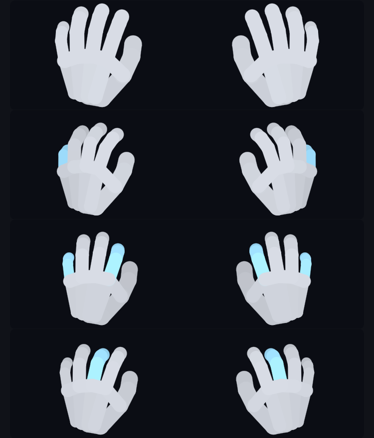

<div align="center">

# Tactile

**모든 타건을, 그 순간 그대로.**


</div>

---

Tactile은 리듬게임을 위한 크로스플랫폼 키뷰어 엔진입니다. 엔진 무관 Core가 입력과 화면의 모든 값을 계산하고, Unity·Godot 어댑터가 그대로 그립니다. 바로 쓸 수 있는 독립 앱과 얼불춤 모드도 함께 들어 있습니다.

## 특징

- **엔진 무관 Core**: 상태·애니메이션·좌표·색은 모두 Core가 계산하고, 엔진은 받은 값을 그리기만 합니다. 같은 레이아웃이 Unity와 Godot에서 똑같이 움직입니다.
- **의존성 없음**: Core는 `netstandard2.0`에 외부 패키지가 없습니다. Unity Mono/IL2CPP, Godot .NET, 일반 .NET 어디서든 로드되고, 모드 로더 환경에서 DLL이 충돌하지 않습니다.
- **프레임 할당 0**: 프레임 루프에서 메모리를 할당하지 않고, 값이 바뀐 프레임에만 다시 그립니다. 애니메이션은 시간 기반이라 프레임 속도와 무관합니다.
- **등록만으로 확장**: 새 요소 종류는 등록표에 로직과 렌더러를 등록하기만 하면 추가됩니다. 기본 렌더러도 바꿔 끼울 수 있습니다.
- **정확한 입력**: macOS와 Windows에서 별도 스레드가 전역 키 이벤트를 고정밀 타임스탬프와 함께 수집합니다 (게임 창에 포커스가 있어도). macOS는 입력 모니터링 권한 확인·요청까지 처리합니다.

## 기본 요소

| 요소 | 종류 ID | 설명 |
|---|---|---|
| `KeyElement` | `tactile:key` | 키 상자. 눌림 전환 애니메이션, 누른 횟수, 키 레인(빗줄기) |
| `StatElement` | `tactile:stat` | 통계 표시: `Kps`, `MaxKps`, `Total` |
| `HandsElement` | `tactile:hands` | 키보드 위 두 손. 누른 손가락과 손 전체가 함께 움직임 |

손 요소는 [ADOFAI Macro 3](https://github.com/CLiF-1593/ADOFAI_Macro_for_Publish)(FFLiK, MIT)의 손 캠을 옮긴 것입니다. 원작의 뼈대 치수, 쉬는 자세, 애니메이션을 그대로 따르되, 원작은 미래 입력을 아는 매크로라서 하던 "준비 동작"만 실시간 입력에 맞게 빠져 있습니다.

<p align="center"></p>

## 프로젝트 구성

```
Tactile.Core               엔진 무관 로직 (netstandard2.0, 의존성 없음)
Tactile.Adapters.Unity     Unity 렌더러 (UnityEngine.UI 없이 엔진 모듈만 사용)
Tactile.Adapters.Godot     Godot 4 .NET 렌더러
Tactile.Standalone         Godot로 만든 독립 앱 (레이아웃 에디터 + 투명 표시 창)
Tactile.ADOFAI             A Dance of Fire and Ice용 MelonLoader 모드
```

## 빠르게 시작하기

### Godot

```csharp
public partial class KeyViewerHost : Node2D
{
    private TactileGodotViewer? _viewer;

    public override void _Ready() => _viewer = new TactileGodotViewer(this, layout);
    public override void _Process(double delta) => _viewer?.Update();
    public override void _ExitTree() => _viewer?.Dispose();
}
```

### Unity

```csharp
_viewer = new TactileUnityViewer(layout);          // 화면 맨 위 오버레이 캔버스에 그림
_viewer.Root.anchoredPosition = new Vector2(20, -20);

// 매 프레임 (메인 스레드)
_viewer.Update();
```

Unity 어댑터는 게임마다 다른 UI 버전에 영향받지 않도록 `UnityEngine.UI` 없이 그립니다. macOS·Windows가 아닌 플랫폼에서는 `Input.GetKey` 폴링으로 입력을 받습니다.

### 새 요소 추가하기

```csharp
var elements = ElementRegistry.CreateDefault();
elements.Register<GraphElement>("myaddon:graph", (element, context) => new GraphBehavior(element));

var renderers = GodotRenderers.CreateDefault();
renderers.Register<GraphElement, GraphVisual>((element, context) => new GraphRenderer(element, context));
```

요소 하나는 네 부분으로 나뉩니다.

1. **레이아웃 데이터** (`LayoutElement` 상속): 직렬화되는 순수 설정
2. **로직** (`ElementBehavior<TElement, TVisual>`): 입력과 프레임 갱신으로 상태 계산
3. **Visual**: 렌더러에 넘기는 엔진 무관 값 (바뀔 때만 `Revision` 증가)
4. **렌더러** (`IElementRenderer<TVisual>`): 엔진별로 그리기만 담당

## 레이아웃 파일

레이아웃은 사람이 읽고 고칠 수 있는 JSON으로 저장하고 불러옵니다. 파일에 없는 값은 기본값을 쓰므로 바꾸고 싶은 것만 적어도 됩니다.

```csharp
LayoutSerializer.SaveFile(layout, "layout.json");
KeyViewerLayout layout = LayoutSerializer.LoadFile("layout.json");
```

```jsonc
{
  "version": 1,
  "canvas": { "x": 750, "y": 696 },
  "elements": [
    {
      "type": "tactile:key",
      "id": "key-Tab",
      "bounds": { "x": 20, "y": 320, "width": 80, "height": 80 },
      "bindings": ["Keyboard.Tab"],
      "label": "Tab",
      "style": {
        "normal": { "fill": "#FFFFFF", "spriteKey": "key-skin" },
        "pressed": { "fill": "#7FD3FFF0" }
      }
    }
  ],
  "assets": [
    { "id": "key-skin", "type": "image", "format": "png", "data": "iVBORw0KGgo..." }
  ]
}
```

- 요소의 공개 속성을 그대로 저장하므로, 애드온 요소도 등록만 하면 따로 코드 없이 저장됩니다.
- 애드온이 빠진 상태에서 불러온 요소는 내용을 보존했다가 다시 저장할 때 그대로 씁니다.
- 이미지는 `assets`에 base64로 함께 들어가므로 파일 하나만 공유하면 됩니다. 요소는 `spriteKey`로 이름을 가리키고, 채우기 색이 곱해집니다. 독립 앱 에디터의 레이아웃 설정에서 가져오거나 창에 끌어 놓으면 됩니다. 얼불춤 모드(Unity)는 PNG·JPG만 표시합니다.
- 독립 앱은 Godot 사용자 데이터 폴더의 `layout.json`, 얼불춤 모드는 `UserData/Tactile/layout.json`을 읽습니다. 파일이 없으면 기본 레이아웃을 그 자리에 만들어 둡니다.

## 얼불춤 모드

[MelonLoader](https://melonwiki.xyz)가 설치된 A Dance of Fire and Ice에서 키뷰어를 띄웁니다.

```bash
dotnet build Tactile.ADOFAI                              # 게임 폴더의 Mods/, UserLibs/에 자동 복사
dotnet build Tactile.ADOFAI -p:GameDir="/path/to/game"   # 게임 경로가 다를 때
```

설정은 `<게임 폴더>/UserData/MelonPreferences.cfg`의 `[Tactile]`에서 바꿉니다.

| 항목 | 기본값 | 설명 |
|---|---|---|
| `Visible` | `true` | 보이기 |
| `ToggleKey` | `F8` | 보이기/숨기기 키 |
| `Anchor` | `BottomLeft` | 기준 화면 구석 |
| `OffsetX`, `OffsetY` | `20` | 구석에서의 거리 (픽셀) |
| `Scale` | `0.6` | 크기 (1080p 기준) |
| `ShowHands` | `true` | 손 표시 |
| `OpenPermissionSettings` | `true` | macOS 입력 모니터링 권한이 없으면 설정 열기 |

## 빌드

```bash
dotnet build Tactile.slnx                                       # 전체 빌드
dotnet build Tactile.Adapters.Godot -p:GodotVersion=4.7.2       # 컴파일용 GodotSharp 버전 (기본 4.4.0)
dotnet build Tactile.Adapters.Unity -p:UnityVersion=2022.3.62   # Unity 참조 버전 (기본 2019.4.41)
```

독립 앱은 Godot 4.7.2 .NET으로 `Tactile.Standalone`을 열어 실행합니다.

```bash
godot --path Tactile.Standalone
```

앱은 레이아웃 에디터로 열립니다. 캔버스에서 요소를 끌어 옮기고 손잡이로 크기를 바꾸며, 오른쪽 속성 칸에서 글자·입력·모양을 고칩니다. 미리보기는 실제 키 입력에 그대로 반응합니다. **▶ 표시**를 누르면 에디터는 사라지고, 배경이 투명한 키뷰어 창만 남습니다. 끌어서 옮기고, 우클릭 메뉴나 더블클릭·Esc로 편집으로 돌아옵니다.

배포용 zip은 `scripts/build.py`로 만듭니다. 결과는 `build/` 폴더에 생기고, 라이선스 파일이 함께 들어갑니다.

```bash
scripts/build.py adofai standalone -v 0.2.0   # 대상: core, unity, godot, adofai, standalone, all
```

> [!NOTE]
> macOS에서는 처음 실행할 때 **입력 모니터링** 권한을 요청합니다. 권한이 없는 동안에는 에디터 위쪽에 안내가 뜨고, 허용하면 키 입력이 자동으로 연결됩니다.

## 라이선스

[MIT](LICENSE) © 2026 Woobeen Jeon

손 요소는 FFLiK의 [ADOFAI Macro 3](https://github.com/CLiF-1593/ADOFAI_Macro_for_Publish)(MIT) 손 캠 코드를 바탕으로 합니다. 저작권 고지와 라이선스 전문은 [THIRD_PARTY_NOTICES.md](THIRD_PARTY_NOTICES.md)에 있습니다.
